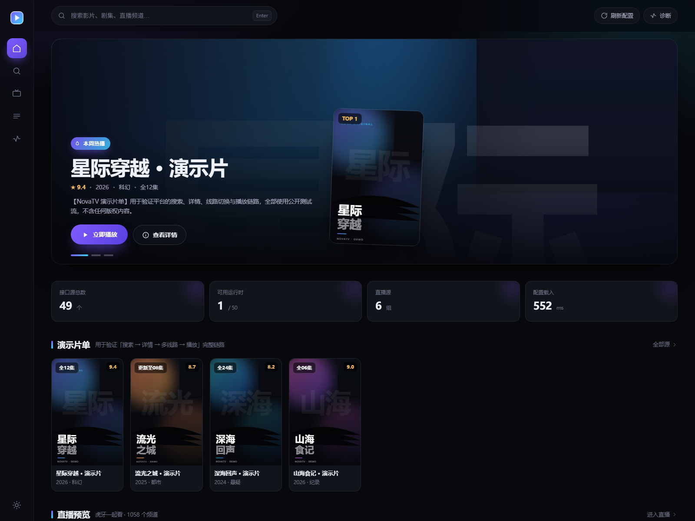

# NovaTV

> 参考 **DecoTV** 的界面设计、借鉴 **TVBox** 的播放原理，实现的一套前后端一体聚合视频平台。
> 已用真实接口 `http://www.饭太硬.cc/tv` 完成端到端验证（20/20 项通过），
> 并实做了 **JS 运行时** 与 **JVM 侧车** 两条 spider 执行路径 —— 见 [运行时方案](docs/RUNTIME.md)。



---

## 特性

- **多源聚合搜索**：一次输入，并发打所有可用源，结果按源分组
- **完整播放链路**：搜索 → 详情 → 多线路/多剧集 → 取流 → 播放
- **三引擎播放器**：HLS（hls.js）/ FLV（mpegts.js）/ MP4（原生），全部本地化，不依赖 CDN
- **跨域与防盗链治理**：`/api/proxy` 统一代理，自动改写 m3u8 分片与密钥 URI，支持 Range 拖动
- **配置载体解码器**：兼容"图片藏 JSON"、base64 盐值、JSONC 注释等 TVBox 生态常见加密玩法
- **JS 运行时（drpy/hipy 兼容）**：Node 里复刻 TVBox QuickJS 宿主（ESM 模块图 + `assets://` + `req/pdfh/pdfa/pd/local`），
  JS 源在服务端直接可搜可播，无需 QuickJS
- **双侧车**：JVM 侧车加载未加固 jar，Android 侧车（redroid/真机）跑加固包，协议一致可互换
- **parse=1 服务端嗅探**：引擎返回网页地址时，抓页面找真直链，找不到就如实标记，绝不猜
- **运行时诊断**：把 spider 包"验尸"给你看（dex / so / guard / MD5），说清哪个源为什么跑不起来
- **直播聚合**：m3u / txt 播放列表解析，频道分组、搜索、直连播放
- **DecoTV 式界面**：Hero 推荐、海报墙、玻璃质感、双主题、桌面侧栏 + 移动底栏
- **零第三方依赖**：后端只用 Node 内置模块，不需要 `npm install`

## 快速开始

```bash
# 环境：Node.js >= 20（无需 npm install）
cd novatv
node server/index.js
# 打开 http://127.0.0.1:8890
```

其他命令：

```bash
npm run dev            # node --watch 热重载
npm run validate       # 端到端验证（20 个用例）
npm run sidecar:jvm    # 编译并启动 JVM 侧车（:8899），加载未加固 jar
npm run docker:preflight   # 没装 docker 也能查：COPY 源、CRLF、镜像名、架构
```

环境变量：

| 变量 | 默认值 | 说明 |
|---|---|---|
| `PORT` | `8890` | 服务端口 |
| `CONFIG_URL` | `http://www.饭太硬.cc/tv` | 接口配置地址（任何 TVBox 配置都行） |
| `SPIDER_JVM_URL` | `http://127.0.0.1:8899` | JVM 侧车地址（未加固 jar） |
| `SPIDER_ANDROID_URL` | `http://127.0.0.1:8898` | Android 侧车地址（加固包，adb forward 出来的端口） |
| `SPIDER_BRIDGE_URL` | 空 | 通用侧车地址（上面两个都没配时用它） |
| `CONFIG_URLS` | 空 | 逗号分隔的额外配置，自动合并站点（jar 源跑不动时用它补 CMS 源） |
| `NOVA_SPIDER_JAR` | demo jar | JVM 侧车要加载的 jar 路径 |
| `JS_RT_DEBUG` | 空 | 置 1 打印 JS 运行时的 req/日志 |

## Docker / NAS 部署

镜像由 GitHub Actions 自动构建，双架构（amd64 / arm64），推就出品：

```
push → lint → build（2 镜像 × 2 架构 → GHCR）→ smoke（真跑容器验健康检查）
```

NAS 上三步：

```bash
cp .env.example .env && vi .env        # 只需要改 GHCR_OWNER
docker compose pull
docker compose up -d                   # http://<NAS-IP>:8890
```

需要 JVM 侧车时叠加一层（会自动把主服务的 `SPIDER_JVM_URL` 指过去）：

```bash
docker compose -f docker-compose.yml -f docker-compose.sidecar.yml up -d
```

完整步骤、GHCR 可见性设置、群晖/威联通图形入口、升级回滚与排障
见 **[docs/DEPLOY.md](docs/DEPLOY.md)**。

## 目录结构

```
novatv/
├─ server/
│  ├─ index.js              # HTTP 服务：API 路由 + 静态资源 + 媒体代理
│  ├─ registry.js           # 适配器注册与选择
│  ├─ config/loader.js      # 配置拉取/多配置聚合、图片载体解码、运行时分类、spider 验尸
│  ├─ adapters/
│  │  ├─ cms.js             # 苹果CMS JSON/XML 适配器（type 0/1）
│  │  ├─ js-spider.js       # JS 源适配器（type 3 + api=.js）
│  │  ├─ spider.js          # jar 侧车桥接（JVM / Android）
│  │  └─ live.js            # m3u / txt 直播源适配器
│  ├─ runtimes/
│  │  ├─ index.js           # 运行时能力矩阵（含侧车健康探测）
│  │  └─ js-rt/             # TVBox QuickJS 宿主复刻
│  │     ├─ loader.js       # ESM→CJS 同步装载 + assets:// 解析 + 磁盘缓存
│  │     ├─ host.js         # req/pdfh/pdfa/pd/joinUrl/local/log
│  │     ├─ http-sync.js    # 同步 HTTP（curl 后端，保证 drpy2 阻塞语义）
│  │     ├─ engine.js       # 引擎容器 + V8/QuickJS 差异自动修复
│  │     └─ sniffer.js      # parse=1 页面的服务端轻量嗅探
│  └─ util/                 # http（UA/hosts 重写/重试）、jsonc、zipinfo
├─ sidecar/
│  ├─ jvm/                  # Java 侧车：URLClassLoader + CatVod 接口 + demo spider jar
│  └─ android/              # Android 侧车：redroid compose + Host APK（DexClassLoader）
├─ web/
│  ├─ index.html            # 单页壳
│  ├─ css/app.css           # 设计系统（CSS 变量 + 双主题 + 响应式）
│  ├─ js/app.js             # hash 路由 + 各视图渲染（零框架）
│  ├─ js/player.js          # 播放器：三引擎 + 自建控制条 + 续播
│  ├─ vendor/               # hls.js / mpegts.js（本地化）
│  └─ assets/               # 演示海报（SVG）
├─ fixtures/mock-cms.js     # 苹果CMS 协议 mock 源（验证点播链路用）
├─ scripts/
│  ├─ validate.mjs          # 端到端验证（20 项）
│  ├─ jvm-sidecar.mjs       # 编译/启动 JVM 侧车
│  ├─ js-rt-probe.mjs       # JS 运行时单点探针（模块图/引擎/搜索）
│  └─ shot.mjs              # 无头截图（CDP）
├─ Dockerfile               # 主服务镜像（node:22-slim + curl + tini）
├─ Dockerfile.sidecar       # JVM 侧车镜像（jdk 编译 → jre 运行）
├─ docker-compose.yml       # NAS 部署编排
├─ docker-compose.sidecar.yml  # 侧车叠加层（-f 叠加使用）
├─ .github/workflows/docker.yml  # lint → 多架构构建 → 推 GHCR → 冒烟测试
└─ docs/
   ├─ ANALYSIS.md           # 两个参考项目的拆解与设计映射
   ├─ RUNTIME.md            # 运行时方案：jar/JS/Android 四条路怎么选
   ├─ DEPLOY.md             # GitHub Actions 打包 + NAS Docker 部署
   └─ VALIDATION.md         # 真实验证报告
```

## API

| 方法 | 路径 | 说明 |
|---|---|---|
| GET | `/api/health` | 健康检查 |
| GET | `/api/config?force=1` | 接口配置快照（载体、耗时、统计） |
| GET | `/api/sources` | 站点列表（含运行时、是否可用） |
| GET | `/api/search?wd=&sites=&limit=` | 聚合搜索，按源分组返回 |
| GET | `/api/category?site=&tid=&pg=` | 分类/首页列表 |
| GET | `/api/detail?site=&id=` | 详情 + 线路 + 剧集 |
| GET | `/api/play?site=&id=&flag=&ep=` | 取播放地址（含代理地址、是否需要解析） |
| GET | `/api/lives` / `/api/live?index=` | 直播源列表 / 展开频道 |
| GET | `/api/runtime` | 运行时能力矩阵（JS/JVM/Android 是否可用 + 侧车健康） |
| GET | `/api/diag` | 配置载体 + spider 验尸 + 运行时统计 |
| GET | `/api/proxy?url=&referer=` | 媒体代理（m3u8 改写、Range 透传、CORS 放行） |
| GET | `/api/probe?url=` | 流类型探测（hls / flv / mp4） |

### Spider 侧车协议（JVM / Android 通用）

```http
POST /spider
{ "site": { "key": "...", "api": "csp_XXX", "ext": "...", "spiderJar": "/path/to.jar" },
  "method": "home|category|search|detail|play",
  "params": { ... } }
→ 200 { "ok": true, "data": "<spider 原始返回值（TVBox JSON 字符串）>" }
→ 200 { "ok": false, "error": "...", "errorClass": "..." }
```

两个参考实现都在 `sidecar/`：`jvm`（`node scripts/jvm-sidecar.mjs`）与 `android`（Host APK + redroid/真机）。
主服务按 `SPIDER_JVM_URL` / `SPIDER_ANDROID_URL` 自动路由，可同时开。

## 已知边界

- **3 个 JS 源**：已在内置 JS 运行时里跑通（虎牙源实测 24 条真实结果 + 嗅探出真 m3u8）。
- **46 个 jar 源**：加固包（dex 仅 36.9 KB，真逻辑在 1.33 MB 的 guard 里），JVM/Node 都拿不到字节码，
  只能交给 Android 侧车。未接设备前它们在 `/api/sources` 里是 `supported:false`，搜索会被跳过并给出原因。
  完整取舍见 [docs/RUNTIME.md](docs/RUNTIME.md)。
- 本机网络下 `tx.hls.huya.com` 的 m3u8 直连返回 403（token 与 IP 绑定），播放链路止于"取址 + 代理改写"。
- `parses`（WebView 解析接口）、`rules`（m3u8 广告清洗）、弹幕未实现，留了扩展位。
- 收藏/续播存 localStorage；要云端同步，替换 `web/js/app.js` 里的 `favAll/toggleFav` 与 `player.js` 的 `writeHistory` 即可。
- 本项目仅用于协议与界面技术演示，不存储、不提供任何片源。

## 参考

- [Decohererk/DecoTV](https://github.com/Decohererk/DecoTV) — 界面范式、代理层、多源聚合产品形态
- [q215613905/TVBoxOS](https://github.com/q215613905/TVBoxOS) — 配置协议、spider 生命周期、播放链路
